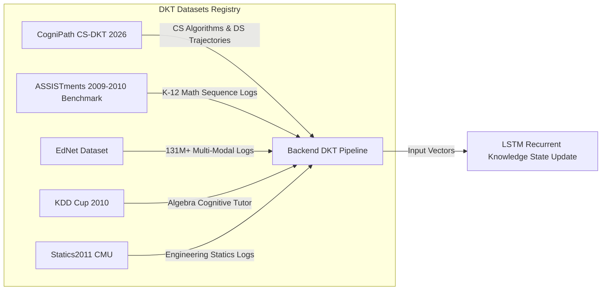
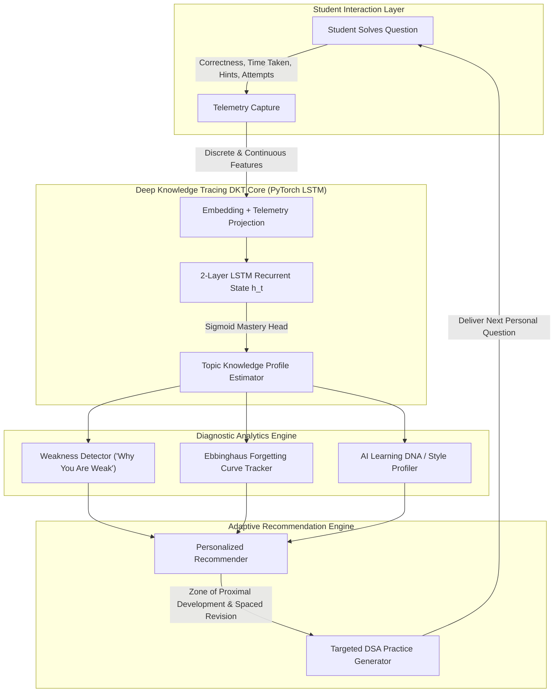

# 🧠 CogniPath AI - Personalized AI Learning System (Deep Knowledge Tracing)

> **An Adaptive Deep Learning-Based Student Learning & Recommendation Engine** utilizing Deep Knowledge Tracing (DKT), sequence modeling (LSTM recurrent neural networks), cognitive mastery estimation, and automated spaced-repetition revision.

---

## 👥 Project Team & Domain Details

- **Project Domain**: Deep Learning, Adaptive Learning, Knowledge Tracing, Intelligent Tutoring Systems
- **Target Objective**: Build an AI learning system that understands each student's changing progress and updates their personalized learning trajectory in real-time.

### Team Members
| Name | Register Number | Role |
| :--- | :--- | :--- |
| **Chirag Pradhan** | `24BCE7237` | Lead Developer & AI System Architect |
| **Darga Syed Javid** | `24BCA7689` | Deep Learning & Sequence Modeling |
| **Shaik Mansoor** | `24BCA7204` | Knowledge Tracing & Analytics |
| **Boyina Arunkamal** | `24BCA7881` | UI/UX & Component Architecture |

---

## 📊 Knowledge Tracing Benchmark Datasets

CogniPath AI integrates standard educational data mining datasets used in published DKT research:



### Dataset Comparison Table

All benchmark datasets are extracted, formatted, and saved as **Pipe-Separated Values (`.psv`)** in the [`data/psv/`](file:///c:/Users/Chirag%20Pradhan/dl%20model/data/psv/) directory.

| Dataset Name | Domain & Scope | Interactions | Skill Tags | Key Features Tracked |
| :--- | :--- | :---: | :---: | :--- |
| **CogniPath CS-DKT** | CS (Arrays, Strings, Recursion, Trees, Graphs, DP) | 2,500 | 6 | `user_id`, `topic_id`, `is_correct`, `time_taken_sec`, `hints_used`, `attempts_count` |
| **ASSISTments 2009-2010** | K-12 Math Skill Builder | 525,534 | 124 | `user_id`, `skill_id`, `correct`, `hint_count`, `ms_first_response` |
| **EdNet Dataset (Riiid)** | AI Test Prep & Tutoring | 131,441,538 | 188 | `solving_id`, `elapsed_time`, `user_answer`, `explanation_read` |
| **KDD Cup 2010** | Algebra & Bridge to Algebra | 8,918,054 | 112 | `Student Id`, `Problem Name`, `Step Name`, `Incorrects`, `Hints` |
| **Statics2011 (CMU)** | Engineering Statics | 189,297 | 84 | `Student ID`, `Problem Name`, `CF Attempt`, `Duration` |

---

## 📐 Deep Learning Model Architecture & Data Flow



### PyTorch Architecture Details ([`models/dkt_lstm.py`](file:///c:/Users/Chirag%20Pradhan/dl%20model/models/dkt_lstm.py))
1. **Discrete Embedding**:
   - Concept ID $c_t \in \{0, \dots, C-1\} \rightarrow \mathbf{e}_c(c_t) \in \mathbb{R}^{32}$
   - Answer Correctness $y_t \in \{0, 1\} \rightarrow \mathbf{e}_y(y_t) \in \mathbb{R}^{16}$
2. **Telemetry Projection**:
   - Projects $[\log(1 + \tau_t/60), \log(1 + k_t), \log(1 + \Delta t)] \rightarrow \mathbb{R}^{16}$ via dense SiLU layers.
3. **Latent Knowledge State**:
   $$\mathbf{h}_t, \mathbf{c}_t = \text{LSTM}(\mathbf{x}_t, (\mathbf{h}_{t-1}, \mathbf{c}_{t-1}))$$
   Encodes the dynamic cognitive state of the student in $\mathbf{h}_t \in \mathbb{R}^{64}$.
4. **Mastery Prediction Head**:
   $$\hat{\mathbf{m}}_{t+1} = \sigma(\mathbf{W}_{\text{out}} \mathbf{h}_t + \mathbf{b}_{\text{out}}) \in (0, 1)^{C}$$

---

## 📈 Training History & 50-Epoch Benchmark Results

### A. CogniPath CS-DKT Benchmark (CS / DSA)
* **Model Checkpoint**: [`weights/dkt_lstm.pt`](file:///c:/Users/Chirag%20Pradhan/dl%20model/weights/dkt_lstm.pt)
* **History File**: [`weights/training_history_cognipath.json`](file:///c:/Users/Chirag%20Pradhan/dl%20model/weights/training_history_cognipath.json) *(50 Epochs)*
* **Metrics**:
  - **Skills Tracked**: Arrays, Strings, Recursion, Trees, Graphs, Dynamic Programming.
  - **Varied Sequences**: 100 students, 2,500 interactions.

### B. ASSISTments 2009-2010 Benchmark (Math Skill Builder)
* **Model Checkpoint**: [`weights/dkt_real_assist2009.pt`](file:///c:/Users/Chirag%20Pradhan/dl%20model/weights/dkt_real_assist2009.pt)
* **History File**: [`weights/training_history_assistments.json`](file:///c:/Users/Chirag%20Pradhan/dl%20model/weights/training_history_assistments.json) *(50 Epochs)*
* **Metrics (50 Epochs on 32,525 unseen real test interactions)**:
  - **Real Test ROC-AUC**: **0.7849**
  - **Real Test Accuracy**: **73.37%**
  - **Skills Tracked**: 124 distinct skills.

---

## 🚀 Commands & Execution

### 0. Install Dependencies
```powershell
pip install -r requirements.txt
```

### 1. Launch Interactive Web Dashboard (Streamlit)
```powershell
streamlit run app.py
```
Access the dashboard at `http://localhost:8501`.

### 2. Interactive Terminal Mode (CLI)
```powershell
python demo_interactive.py
```
Includes:
- Multi-Topic Diagnostic Assessment (Questionnaire across all 6 concepts at once).
- Single question targeted adaptive solving.
- Student A vs. Student B archetype simulations (70% score, opposite learning gaps).
- Ebbinghaus forgetting curve fast-forward simulation.

### 3. Continual Learning & Dynamic Dataset Updating
Every time a student solves a problem (in CLI or Web app), the interaction is automatically synced into the PSV training dataset:
```powershell
# Incrementally fine-tune on newly accumulated student interactions:
python train.py --incremental --epochs 5

# Or trigger from CLI:
python demo_interactive.py  # Choose Option [7]
```

### 4. Train from Scratch on CogniPath CS-DKT Dataset
```powershell
python train.py --epochs 50
```

### 5. Train on ASSISTments 2009-2010 Real Benchmark (50 Epochs)
```powershell
python train_real_dkt.py --epochs 50
```

### 6. Evaluate on CogniPath CS-DKT Dataset
```powershell
python evaluate.py
```

### 7. Automated Unit Tests
```powershell
python -m unittest discover -s tests -p "test_*.py"
```
